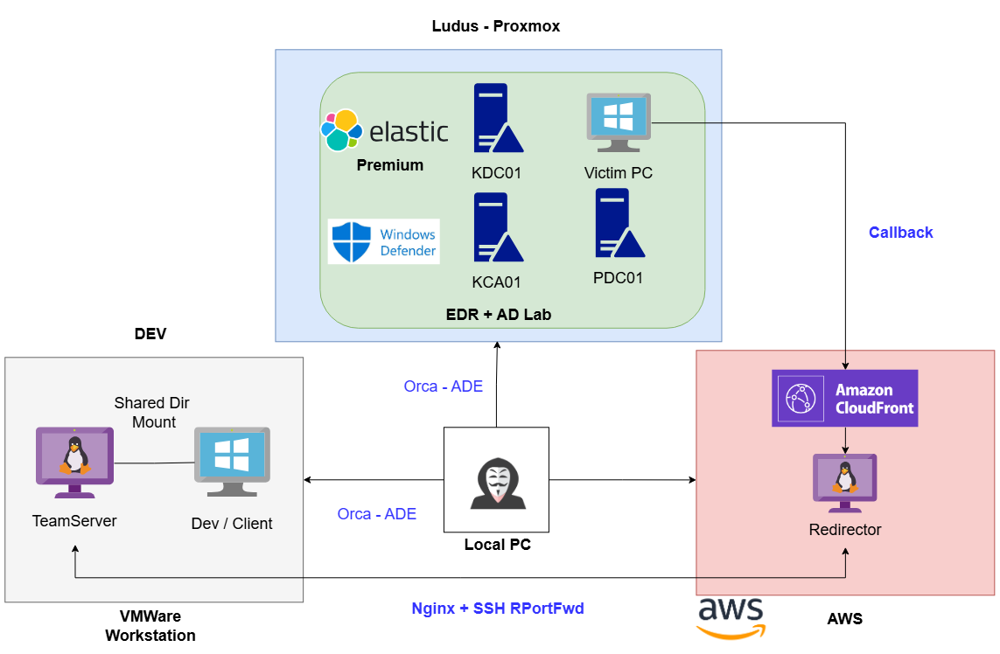

# 2. 환경 설정

## 환경

<figure><figcaption></figcaption></figure>

오퍼레이션 트리플 배럴이 제작된 인프라다. 특별할 것은 없지만, 어떤 환경, OS, 솔루션, 방법을 이용해 트리플 배럴이 제작됐는지 맥락을 파악하기 위해서 준비한 다이어그램이다.&#x20;

### 대상

* OS: 하이퍼바이저에서 실행중인 최신 버전의 윈도우 서버 2022
* AV/EDR: Elastic Premium, v.9.4.2 (EDR) + Windows Defender 최신 버전 (AV)
* 콜백: 대상 PC -> AWS Cloudfront -> SSH Reverse Port Forwarding -> 공격자 팀서버

### Elastic

<figure><figcaption></figcaption></figure>

EDR은 기본적으로 Prevention은 비활성화하고, Detection만 활성화했다. 물론, 둘 다 같은 성능을 보여주기 때문에 큰 상관은 없다.&#x20;

**SIEM Policy**

* Elastic + Elastic Security, v9.4.2, Premium 라이센스 30일 무료 평가판 사용&#x20;
* SIEM 룰에서 `Memory, Kerberos, Credentials, Tickets, Powershell, "Defend", NTLM, Token` 활성화&#x20;
* 약 \~283개의 SIEM 룰 활성화&#x20;

**Agent Policy**&#x20;

* Malware Protections 활성화
* Ransomware Protections 활성화
* Memory Threat Protections 활성화
* Malicious Behavior Protections 활성화
* Attack Surface Reduction - Credential Harvesting 활성화
* Event Collection 모두 활성화

### Windows Defender&#x20;

기본적인 윈도우 디펜더를 AV 대신 사용했다. 최신 버전으로 업데이트 한뒤, Real-time Protection과 Cloud-delivered protection 모두 활성화 했다.&#x20;

<figure><figcaption></figcaption></figure>

### 공격 시나리오 & 탐지/대응&#x20;

추후 `Operation` 섹션에서 더 나오겠지만, 오퍼레이션 트리플 배럴은 단순하게 에이전트 콜백을 받았다고 해서 끝이 아니라, 콜백 이후 내부 정찰, AD 권한 상승 공격, RDP/SSH 터널링, 횡적 이동까지 다양하게 진행했다.&#x20;

보고서에 나온 코드와 기법들은 모두 EDR이 없거나 무력화된 대상으로 사용된 것들이 많아서, 아이러니하게도현실적이지만 현실적으로 보기가 어렵다. 모든 레드티머들이 AV/EDR 없이 보안을 신경쓰지 않는 회사를 대상으로 침투를 수행하는 것도 아니고, 고객사에 들어가자마자 EDR 내려버리고 4주동안 업무를 할 수도 없기에, 일단은 최대한 방어 회피 기법들을 챙기되, 필요한 경우에는 따로 툴 개발을 통해 EDRChoker/EDRSilencer 등의 도구를 사용했다.&#x20;

