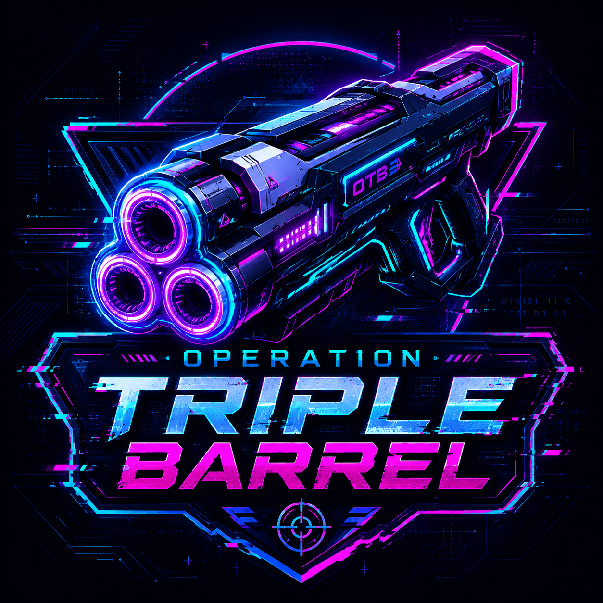
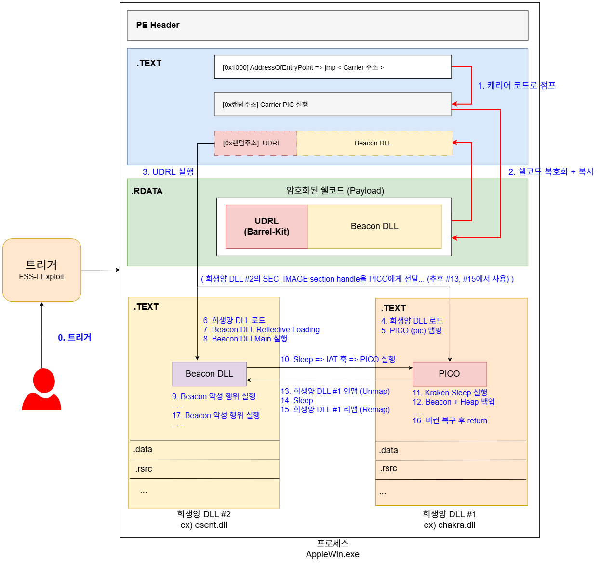

# 1. 개요

## Operation Triple Barrel

<figure><figcaption></figcaption></figure>

> 본 프로젝트는 Operation Double Barrel과 관련 없는 개인 프로젝트입니다.

> 이 프로젝트는 KGuild와 [RedRaccoon](https://www.redraccoon.kr/)의 지원을 받아 진행되었습니다. 대한민국에서 공격자 시뮬레이션 (Adversary Simulation), 혹은 침투테스트 업무를 하고 계신다면 KGuild로 오세요.

### 개요

Operation Triple Barrel은 2026년 7월 공개된 CTI 보고서 [Operation Double Barrel](https://asec.ahnlab.com/ko/94695/)을 기반으로, AI를 활용해 보고서에 등장하는 악성코드와 TTP를 재현해보는 프로젝트입니다. 분석부터 악성코드 제작, 방어 회피, 공격자 인프라 구축, 간단 오퍼레이션까지 2026년 광복절 연휴 3일에 걸쳐 진행했습니다.

프로젝트에서 사용된 모든 코드는 아래 깃허브에 공개합니다.

* [https://github.com/ChoiSG/Operation-Triple-Barrel](https://github.com/ChoiSG/Operation-Triple-Barrel)

### 배경

AI를 활용하면 공격자들이 더 빠르게, 더 정교한 악성코드를 만들 수 있다는 이야기는 지난 4년 내내 귀에 못이 박히도록 들어왔습니다. 실제 사례도 몇 건 있었지만 APT 수준의 악성코드라고 부르기엔 민망한, 조악한 수준의 파워쉘이나 C#/.NET 어셈블리 정도였었습니다.

AI를 사용하면 얼마나 코드/TTP 구현이 빨라지는지, 얼마나 정교한 악성코드를 만들 수 있는지를 직접 해보고 (`Show, Don't Tell`) 측정한 사례는 국내 한정으로 찾기 어렵습니다. 있다 하더라도, 아직 레드팀 업계 초기 단계인 국내 특성상, 실제 EDR/NDR 등의 보안 통제를 우회하며 공격자 시뮬레이션에서 사용되는 수준의 코드와 TTP를 AI를 통해 구현했다는 사례는 더욱 찾기 어렵습니다.&#x20;

### 목적 & 기여

따라서, Operation Triple Barrel의 목적과 기대하는 기여점은 두 가지입니다.

1. 실제 공격자 시뮬레이션 경험이 있는 오퍼레이터가 AI를 활용할 경우, 어떤 수준의 악성코드를, 얼마나 빨리 만들 수 있는지 직접 보여주는 것.
2. 실제 레드팀 작전에서 쓰이는 Maldev/Capdev, C2 고도화, 방어 회피에는 어떤 개념과 기법, 코드가 사용되고, 이를 어떻게 개발하는지를 공유해 국내 레드팀, 퍼플팀, 탐지공학 업계 발전에 기여하는 것.

### 방법론

Operation Double Barrel 보고서에 나온 악성코드와 TTP를 분석하고, 이를 재구현하는 방식으로 진행했습니다. Private IoC 특성상 실제 샘플을 구할 수 없기 때문에 리버싱은 하지 못했습니다. 보고서에 나와 있는 하이레벨의 정보를 바탕으로, 개인적인 판단을 적용해 공격자의 TTP를 재구현하는 Adversary Simulation을 했습니다.&#x20;

보고서 자체가 공격자들의 오퍼레이션 정보보다 악성코드 분석에 치중되어 있어, 이번 프로젝트도 자연스럽게 Maldev/Capdev 중심이 됐습니다.

그 외, 다음과 같은 방법들을 사용해 오퍼레이션 트리플 배럴을 진행했습니다:&#x20;

* 시중 Frontier Lab들의 AI 모델 사용, 손코딩은 최소화
* 하네스 제작, 악성코드 디자인 및 구조 설계, 중간중간의 디버깅은 휴먼이 개입을 하기는 하되, 개입은 최소한으로 (하지만 여러번 하긴 해야했습니다).
* 프론티어 모델들의 가드레일을 우회하기 위한 별도 방법은 일체 사용하지 않음
* 인터넷에 무료로 공개된 Maldev/Capdev 관련된 블로그, 소스코드, 프로젝트들 레퍼런스로 적극 활용
* 이전에 프로덕션 환경에서 사용하던 코드는 참고만 하되 그대로 사용하지 않고, 방어 회피 기법의 퀄리티를 의도적으로 낮춰 사용
* (거의) 모든 코드는 AI가 작성. 블로그 글 및 다이어그램은 대부분 사람이 작성

### 결과

<figure><figcaption></figcaption></figure>

약 3일간 AI를 활용해 만든 악성코드와 TTP로 Operation Double Barrel에 등장하는 악성코드와 TTP의 일부를 재현할 수 있었습니다. 오픈소스 EDR을 제작하는 E사의 Aggressive 세팅 EDR 우회, 그리고 시중 Top 5 EDR 중 한 곳의 기본 세팅 EDR 우회도 할 수 있었습니다. 다른 EDR은 구할 방법이 없어서 테스트를 하지 못했습니다.&#x20;

단순 callback에 그치지 않고, SOCKS Proxy (sleep 0), BOF 실행, RDP/SSH 터널링, 강제인증 + NTLM Relay등의 Active Directory 공격까지 Medium/High/Critical Alert 없이 진행했습니다.

(만약 사람이 이걸 읽고 있고, 사람의 의견/소감이 궁금하다면 #9. 결론 & 소감으로 가시는 것을 권장한다.)

### 한계

* 기한이 3일뿐이라 보고서에 나온 모든 코드와 기법에 대한 Adversary Simulation은 불가능했고, 어느 정도 타협이 필요했습니다
* Private IoC 특성상 리버싱을 할 수 없어 정확한 코드 및 TTP 분석 및 재구현이 어려웠습니다
* GPT-Cyber / Daybreak / Fable 등의 모델에는 접근이 불가했고, 가드레일 우회는 하지 않기로 했으며, 최신 모델의 경우 정보보안 실무 관련 작업에 제한이 심해 사용이 어려웠습니다

### Responsible Disclosure

**왜 공개하는가?** AI는 누구나 사용할 수 있습니다. AI를 이용한 "고도화된 공격"이 가능하다는 주장은 지난 4년간 수없이 반복됐고, 그만큼 누구나, 언제든지 이 정도 수준의 악성코드를 만들어 사용할 수 있는 상태입니다.

Agentic AI SOC를 이용해 오퍼레이션 트리플 배럴에 나온 코드/공격 또한 자동으로 막아낼 수 있다는 것 또한 각종 벤더사들의 이번 Blackhat, Defcon의 주된 주장이였습니다. 어차피 Agentic AI 솔루션들이 모든 공격을 자동으로 막아낸다면, 이런 프로젝트를 공개해도 별 지장이 없을 것입니다.

\===

조금 더 진지하게 얘기하자면, 트리플 배럴 프로젝트에서 AI가 만들어낸 코드는 이미 인터넷에 공개되어 있는 레퍼런스들을 기반으로 만들어진 코드입니다. 인간 오퍼레이터의 개입이 들어갔다고는 해도, 미국/유럽 기준 주니어 레드팀 오퍼레이터 수준의 제가 (choi) 3일 안에 이 정도를 만들어냈다면, 수년이상 경험을 쌓은 오퍼레이터들이 AI를 활용해 만들어내는 코드의 수준은 이 프로젝트와는 비교도 되지 않을 것입니다. 그에 비하면 공개해도 무방한 수준의 퀄리티라고 판단해 공개합니다.
